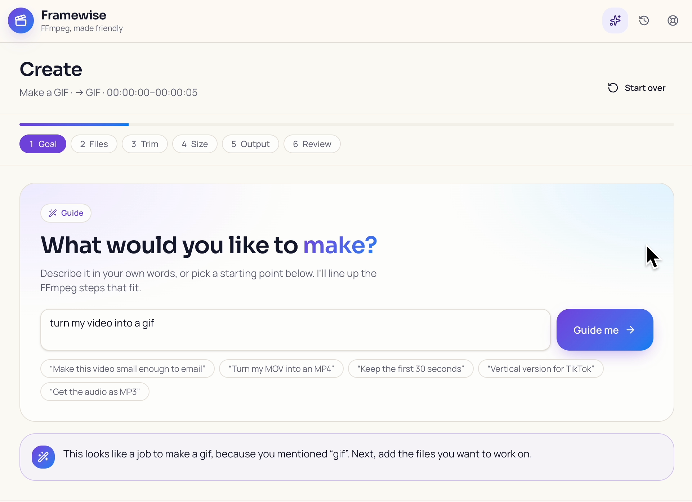
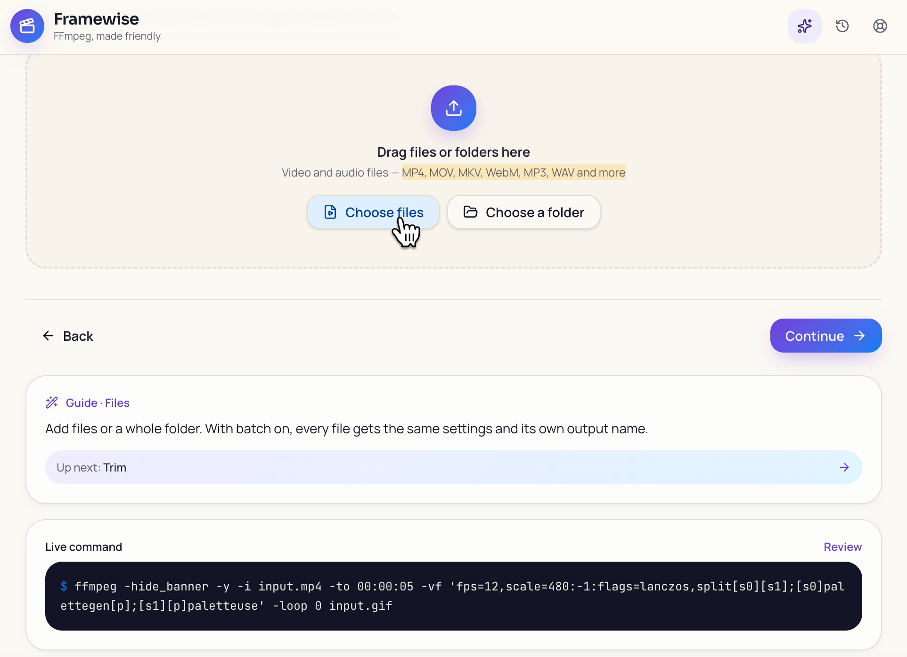
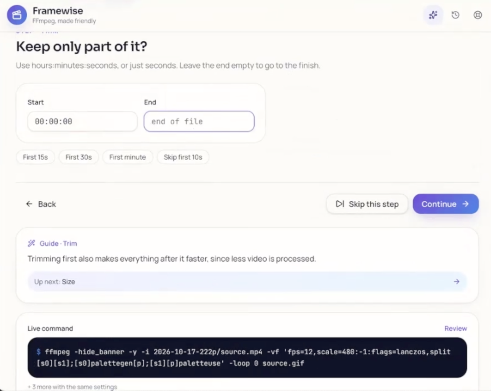
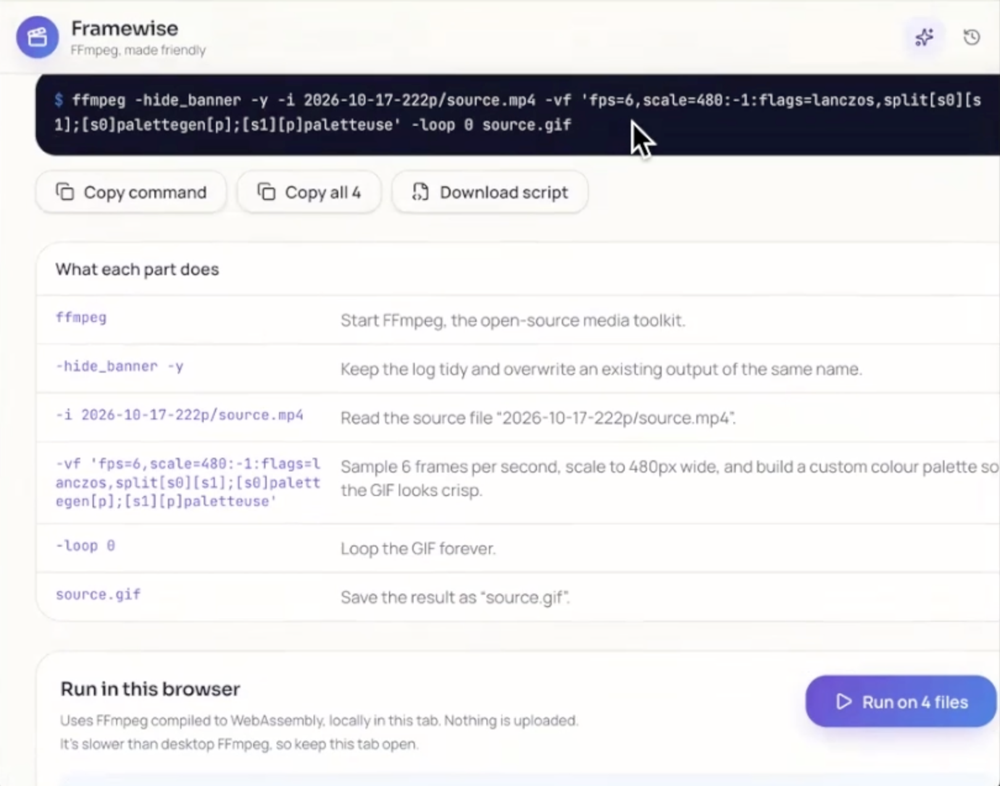
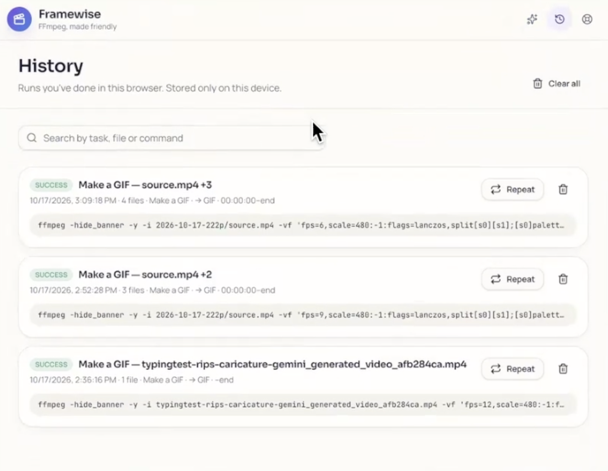
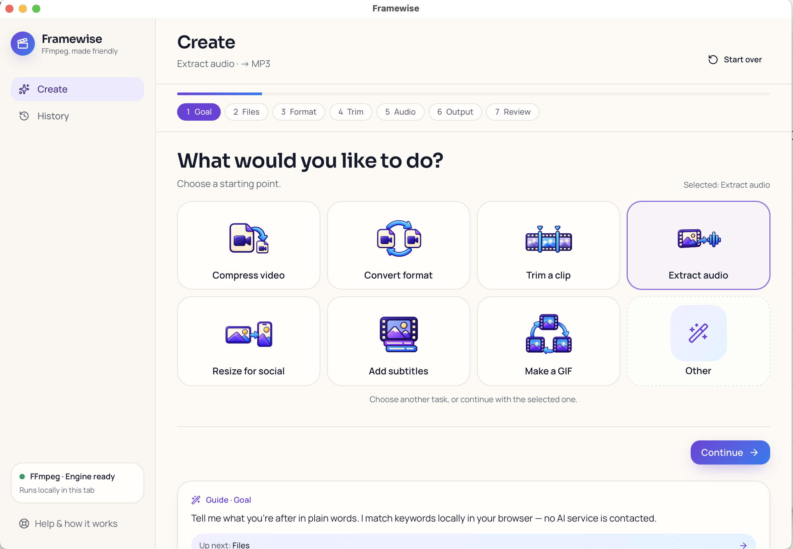

# Framewise

<p></p>

**TL;DR**
FFmpeg GUI guide to help you get the command line to trim, resize or convert video, audio, & make gifs too!
Runs in your browser; your media stays on your device. 
Keeps track of previous history, to run again later.
Can also process bulk files from folder too!

- To run the web app locally: Node.js (includes npm) and a current desktop browser. Desktop FFmpeg is optional.
- An internet connection is needed to install the app and download its browser FFmpeg engine on first conversion.
- Install desktop FFmpeg only if you want to run copied commands in a terminal.


## Choose an edition

| Edition | Status | What it offers |
| --- | --- | --- |
| **Web V1** | [Try V1 online](https://framewise-v1-demo.ripleyjene.chatgpt.site/) | Original text-first starting screen; no installation. The [local setup](#web-app-install) is still available. |
| **Web V2 UI preview** | [Try preset-first V2 online](https://framewise-v2-presets-demo.ripleyjene.chatgpt.site/) | Preset buttons appear first; **Other** opens the text box. [Web preview release notes](https://github.com/ripscreates/framewise/releases/tag/v2.0.0-web-preview.1). |
| **macOS app (V2)** | Developer preview | Apple Silicon; macOS 12 or newer. [Download Mac Preview 1](https://github.com/ripscreates/framewise/releases/tag/v2.0.0-preview.1). |

Both online demos use FFmpeg WebAssembly in the browser. They are UI feedback previews, separate from the Mac app and its unfinished V2.1 native-engine work. The online V2 preview does **not** use the native Mac engine.

### Help compare the two web interfaces

Try the same small media task in [V1](https://framewise-v1-demo.ripleyjene.chatgpt.site/) and [preset-first V2](https://framewise-v2-presets-demo.ripleyjene.chatgpt.site/). If you're testing with someone else, alternate which version you try first. Please [send feedback through GitHub Issues](https://github.com/ripscreates/framewise/issues/new/choose): include your browser and operating system, the task you tried, which start felt clearer, where you hesitated, and whether the output downloaded and played. These demos do not randomly assign visitors or collect comparison analytics.

**Browser memory:** Conversion runs on your computer and may need several times the input file's size in memory. Large files, 4K video, and big batches can slow or freeze the tab. Start with a small file; use desktop FFmpeg for larger jobs. The FFmpeg browser engine downloads on first use (about 31 MB).

**FFmpeg, made friendly.** Framewise is a web app that turns common media tasks into clear, reviewable FFmpeg steps. Choose what you want to do, adjust the options, then run the conversion in your browser or copy the command for desktop FFmpeg.

<p></p>

Framewise's opening screen: guided task setup.


## What you can do

- Convert or compress video
- Trim a clip, extract audio, resize for social formats, add subtitles, or make a GIF
- Work with several files and folder selections
- Review and copy the FFmpeg command before running it
- Search browser-local history and repeat a previous setup

_The guided “describe what you want” helper uses local keyword matching and presets. It does not call an AI service and does not need an OpenAI API key. The guided workflows cover a useful subset of FFmpeg; they do not expose every FFmpeg option._

## How file processing works

When you choose **Run in browser**, Framewise uses FFmpeg compiled to WebAssembly inside the browser tab. On the first conversion, it downloads the FFmpeg engine (about 31 MB) from [unpkg](https://unpkg.com/); keep an internet connection available for that download. The app does not upload the selected media files. Run history—including file names and sizes, settings, command text, and results—is saved in that browser’s local storage. Clearing site data clears that history.

Browser conversion can be slower than desktop FFmpeg and uses browser memory. The app warns that files above roughly 1.5 GB may exceed available memory. For long, 4K, or larger jobs, use the **Copy command** option with desktop FFmpeg. Subtitle burn-in may also need fonts that are not included in the browser engine.

## Requirements

- A desktop computer running a current version of macOS, Windows, or Linux
- [Git](https://git-scm.com/downloads) to download the source
- [Node.js 22.12.0 or newer](https://nodejs.org/en/download). Use a currently supported LTS release; Node.js 24 is the recommended LTS line as of October 2026. Node.js includes npm, which this repository uses to install the exact versions recorded in `package-lock.json`.
- A current desktop browser with WebAssembly and Web Worker support. Chrome, Edge, Firefox, and Safari are suitable starting points.
- An internet connection to clone the repository, install dependencies, and download the browser FFmpeg engine on its first run

**Desktop FFmpeg is optional.** You do not need FFmpeg installed on your computer to convert files in the browser. Install it separately if you want to run copied commands from a terminal. Start at [FFmpeg’s download page](https://ffmpeg.org/download.html) and follow its links for your operating system. After installation, open a new terminal and confirm `ffmpeg -version` works.

Copied desktop commands and downloaded command scripts use POSIX shell syntax. On Windows, run them in Git Bash or WSL; native PowerShell and Command Prompt syntax is not generated yet. This limitation does not affect **Run in browser**.

Directly saving output to a chosen folder is supported in Chrome and Edge on desktop. Other browsers can download each finished file individually.

## Install and run Framewise

<a id="web-app-install"></a>
### Web app (V1 — local setup)

### 1. Install Git and Node.js

Install Git from [git-scm.com/downloads](https://git-scm.com/downloads). Install the current Node.js LTS release from [nodejs.org](https://nodejs.org/en/download); npm is included with Node.js.

Close and reopen your terminal after installation, then check that the tools are available:

```sh
git --version
node --version
npm --version
```

Use Node.js 22.12.0 or newer and npm 10 or newer.

### 2. Download the repository

In Terminal, PowerShell, or your preferred shell, move to the folder where you want the project and run:

```sh
git clone https://github.com/ripscreates/framewise.git
cd framewise
```

The repository is public, so anyone can clone it with the commands above.

### 3. Install the saved dependencies

Run this from the `framewise` folder—the folder that contains `package.json` and `package-lock.json`:

```sh
npm ci
```

`npm ci` installs the versions saved in `package-lock.json`. If you see an error saying `package.json` cannot be found, check that the terminal is inside the `framewise` project folder before continuing.

### 4. Start the app

```sh
npm run dev
```

Leave that terminal window open. The terminal prints the local address for the app; open that address in your browser. It is usually `http://localhost:5173`. If that address is already in use, Vite prints a different one—use the address shown in the terminal.

### 5. Try a first conversion
1. Choose a small audio or video file that you are comfortable using as a test.
2. Describe the task or select a workflow such as **Convert**, **Compress**, or **Trim**.
3. Choose or skip the suggested steps until you reach the review screen.
4. Review the command and output name.
5. Choose **Run in browser**. The first run downloads the FFmpeg engine; keep the tab open while it loads and converts.
6. Save the result to a folder in Chrome or Edge, or use the download button. Open the result to confirm it plays as expected.
7. Open **History** to review the completed run. To repeat it, select the task and add the input files again.

To stop the local app, return to the terminal and press **Ctrl+C**.

### macOS app (V2 — developer preview)

**Download:** [Framewise V2 Preview 1 for Apple Silicon (.dmg)](https://github.com/ripscreates/framewise/releases/tag/v2.0.0-preview.1). Requires an Apple Silicon Mac running macOS 12 or newer; Intel Macs are not supported.

1. Open the downloaded DMG and drag **Framewise** to **Applications**.
2. Eject the DMG, then try opening Framewise from Applications.
3. This preview uses an ad-hoc signature and has not been notarized. If macOS blocks it, and you trust this download from the official Framewise GitHub release, open **System Settings → Privacy & Security → Open Anyway** and confirm.
4. An internet connection is needed for the first conversion to download the FFmpeg WebAssembly engine from unpkg. The app does not include a native FFmpeg executable.

This V2.0.0 developer preview uses FFmpeg WebAssembly, not the planned native Mac engine. V2.1 development adds the Rust native runner, engine selection, capability checks, and Mac file/output handling. It is not ready to download until the signed bundled engine, native conversions, update delivery, and clean-Mac installation are verified. The current preview has not been validated on a clean Mac or checked with an end-to-end media conversion.

## Screenshots

### Web app (V1)

<p></p>
<br><br>
<p></p>
<br><br>
<p></p>
<br><br>
<p></p>
<br><br>
<p></p>
<br><br>

### macOS app (V2 development preview)

<p></p>

Early V2.0 desktop-window preview. It processes media with FFmpeg WebAssembly; the V2.1 native FFmpeg engine and all-in-one Mac release are still in development.

## Video walkthrough

<p align="center">
  <a href="https://youtu.be/GJgC2bECqpE">
    
  </a><br />
  <em>Framewise web app walkthrough (1:52).</em>
</p>


## Optional: build a production version

From the project folder:

```sh
npm run build