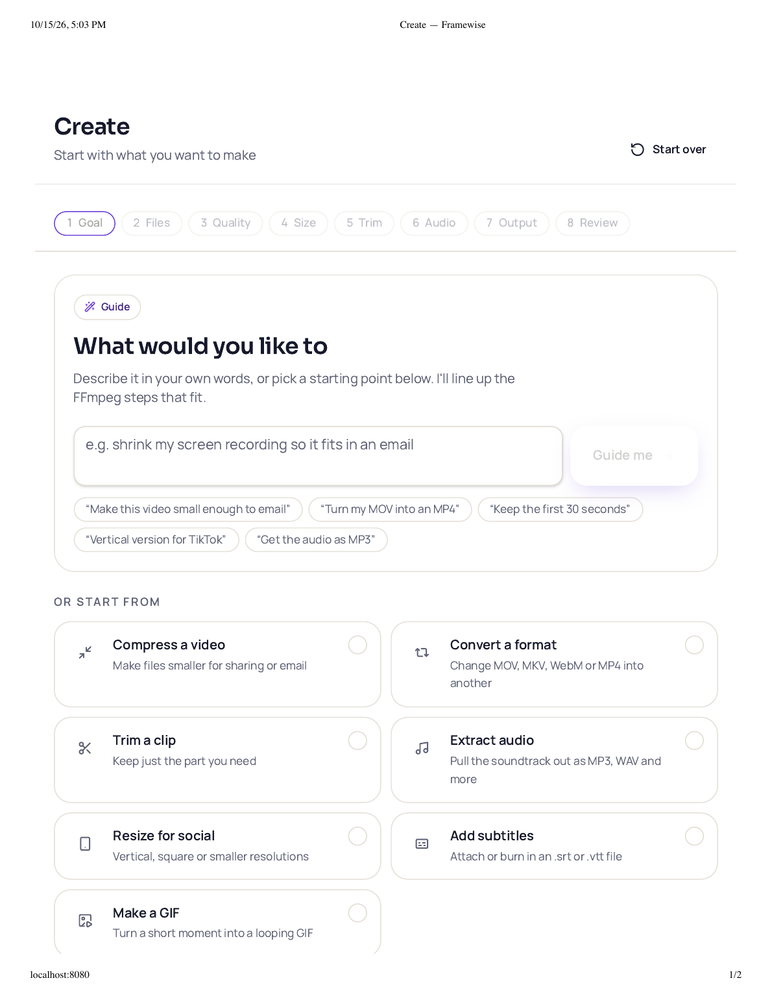
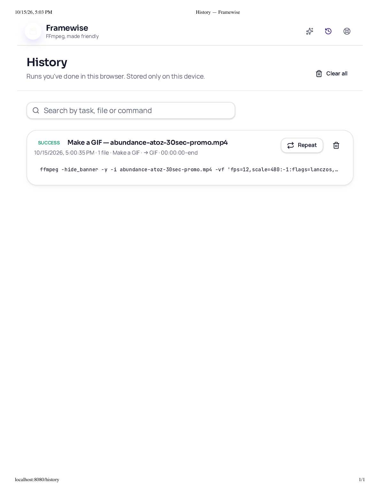
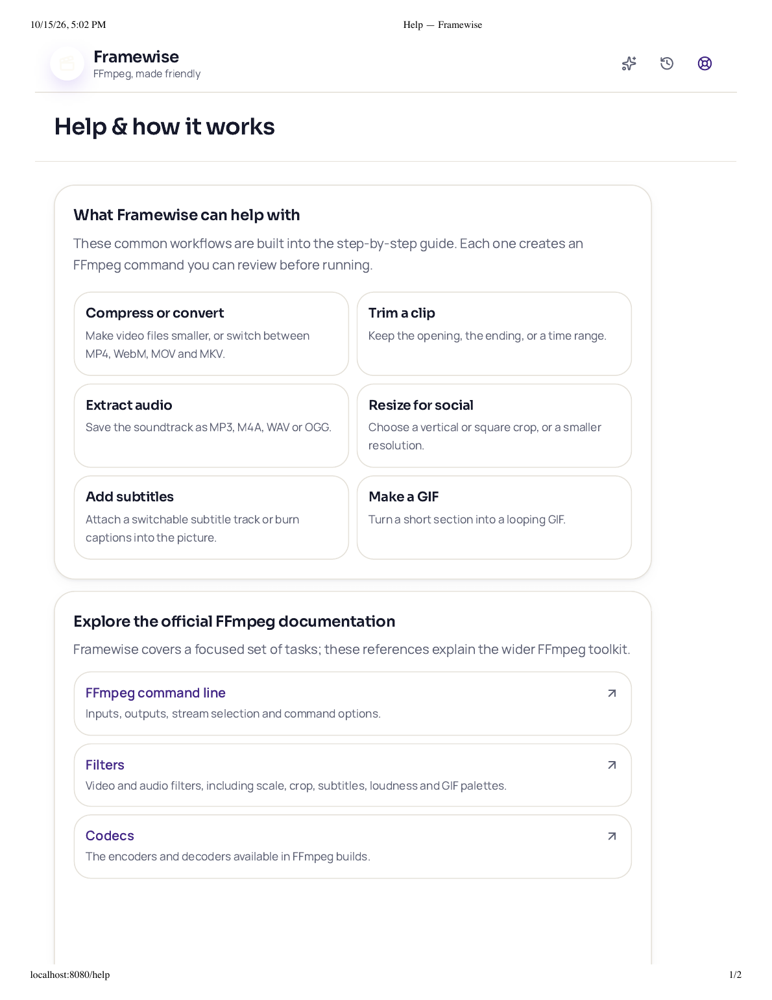
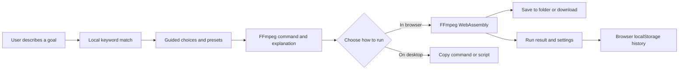

# Framewise V1 Retrospective

## From FFmpeg commands to a guided media workflow

**Case study prepared:** October 15, 2026  
**Scope:** V1 product and UX evolution, current implementation, lessons, and a starting point for V2.  
**Status:** Retrospective only. No V2 interface changes are included here.

## Executive summary

Framewise turns common media-editing goals into understandable FFmpeg choices. A user can describe an outcome or pick a workflow, move through a short sequence of optional decisions, review the generated command, and either run it in the browser or take it to desktop FFmpeg.

The product grew from a Lovable prototype into a maintained application in the private `ripscreates/framewise` repository. The first version now includes seven guided tasks, batch file handling, browser-based FFmpeg WebAssembly processing, command explanations, local run history, and help links to the broader FFmpeg documentation.

The strongest V1 design decision was to make the user's goal the starting point instead of asking them to know FFmpeg flags. The clearest V2 opportunity is to preserve that guidance while reducing how much reading each screen requires.

## Timeline

| Date | Milestone | What changed or was learned |
|---|---|---|
| **Oct 12, 2026** | Lovable prototype and first handoff | Framewise was shaped as a friendly FFmpeg guide with Create, History, and Help pages. The first handoff recorded the seven target workflows, folder and batch handling, command review, browser execution, and local history. The project was ready in Lovable, but source code had not yet been consolidated in the user's local project folder. |
| **Oct 12-13** | Source import and master-repo decision | The downloaded Lovable files were kept separately in `L_framewise`. The user chose `ripscreates/framewise` as the master. [PR #1](https://github.com/ripscreates/framewise/pull/1) recreated the app in that repo and merged Oct 13. |
| **Oct 13** | Project status documented | [PR #2](https://github.com/ripscreates/framewise/pull/2) added a durable status, known gaps, and next steps so work could continue outside the Lovable workspace. |
| **Oct 13-14** | Tool and AI scope clarified | Dyad and Lovable were considered as editing tools. A Dyad API-credit issue made the coding assistant inconvenient, but it did not block the app. The user chose a local keyword-and-lookup guide grounded in FFmpeg documentation for V1, so Framewise does not need a model API or secret key. |
| **Oct 14** | Reliability and help improvements | [PR #3](https://github.com/ripscreates/framewise/pull/3) preserved folder-relative input paths in desktop commands, made unknown requests show supported workflows instead of silently choosing Convert, and expanded Help with capability descriptions and official references. The user merged it. |
| **Oct 14-15** | Local setup and first run | The working copy was one directory deeper than expected, which caused the initial `package.json` lookup error. npm then failed inside its dependency resolver; the log showed successful registry responses before the internal error, and `pnpm` was not initially available as a shell command. The user later confirmed the app runs locally on Oct 15; the exact successful install command was not captured. |
| **Oct 15** | Interface capture and successful GIF run | The supplied local browser captures show the Create, History, and Help screens. The History capture includes a successful GIF job. This is evidence of one completed workflow, not a full compatibility or batch validation. |

## V1 experience

### Create: start with an outcome

The first screen offers a plain-language prompt, example requests, and selectable task cards. A visible step row and a live command preview make the workflow's progress and technical result easier to understand.

*Browser-printed capture from the local app on October 15, 2026. The starting choices are Compress, Convert, Trim, Extract audio, Resize, Subtitles, and GIF.*

### History: make a completed task reusable

History stores task settings and outcomes in the current browser. A successful item can be repeated without rebuilding the settings; the user selects the files again because the browser does not preserve file access.

*Browser-printed capture from the local app. It shows one successful GIF run and its Repeat action. It demonstrates the intended history loop, but does not establish that every workflow or browser is reliable.*

### Help: set expectations and point to the wider toolkit

Help explains the supported subset, local processing, and browser limits. It also links users to official FFmpeg command-line, filter, codec, and format references for work outside the guided wizard.

## What the project taught us

| Learning | Evidence from V1 | Design implication for V2 |
|---|---|---|
| **People can describe the result without knowing the tool.** | The flow begins with “What would you like to make?” and maps matching phrases to a supported workflow. | Keep goal-first language. Use short outcome labels and optional examples instead of making FFmpeg terminology the navigation. |
| **Progressive disclosure helps, but the screens can still feel wordy.** | The wizard makes optional steps skippable and offers a concise step path, while task cards and explanations use several lines of text. | Reduce repeated explanation. Keep a short label visible and reveal details when a user asks for them or reaches command review. |
| **Generated commands need to feel reviewable, not mysterious.** | The app shows a copyable command and explains each part before a browser run. The folder-path fix followed a review of how selected folder paths differ from file names. | Keep a plain-language summary near the main action; leave the full command and technical detail available on demand. |
| **Local processing is a product benefit with a first-run cost.** | Media is processed in the browser with FFmpeg WebAssembly, while the engine is downloaded from a CDN on first use (about 31 MB). | Explain the initial wait at the moment it matters. Keep file handling and privacy language visible without making every screen a privacy essay. |
| **Batch is more than selecting multiple files.** | One set of settings is applied to the queue, while output names need to stay distinct and usable for browser downloads and desktop folder commands. | Make “same settings for all files” and the destination easy to see. Show a file count and clear per-file completion states. |
| **A transparent local guide is enough for the current scope.** | V1 uses local keyword matching, makes no model call, and links to the larger FFmpeg reference set. | Improve coverage and recovery for unrecognized requests before introducing the cost, privacy, and maintenance of a live AI service. |
| **Tool choice matters less than a reliable source of truth.** | Separating `L_framewise` from the master `framewise` repo clarified where reviewed changes belong. | Continue from the master repository. Treat visual builders as optional accelerators, not competing sources of truth. |
| **Developer setup is part of the first-use experience.** | The extra nested folder and npm resolver crash delayed the first local run even though the application itself was intact. | Pin and document one package manager and lockfile, and make the first-run instructions match the actual repository root. |

## Technology and architecture

| Layer | V1 implementation | Role |
|---|---|---|
| UI language and runtime | TypeScript, React 19 | Typed app components and browser UI. |
| App and routing | TanStack Start and TanStack Router | Create, History, and Help routes with client-side navigation. |
| Development and build | Vite 8; Lovable's TanStack/Vite config; Nitro configured for a Cloudflare module output | Local development and production build. The Cloudflare output is configuration, not evidence of a deployed site. |
| Styling and controls | Tailwind CSS 4, Radix UI components, Lucide icons | Responsive layout, accessible control primitives, and task icons. |
| FFmpeg execution | `@ffmpeg/ffmpeg`, `@ffmpeg/util`, FFmpeg WebAssembly core | Loads on first run and processes media inside the browser tab. The V1 core is fetched from unpkg. |
| Intent guidance | Local regular-expression and keyword rules in `src/lib/intent.ts` | Suggests a supported workflow and simple presets; no AI API, server endpoint, or prompt upload. |
| Files and outputs | Browser File APIs, drag/drop and directory selection; File System Access API where supported | Accepts files/folders, runs a batch, then saves to a selected folder or downloads outputs. |
| History | Browser `localStorage` | Saves run settings and outcomes on the current device, up to 200 records. Media files themselves are not retained in History. |
| Data backend | None in V1 | No user account, cloud media storage, or application database is needed for the current workflow. |

## V2 opportunity: less reading, same confidence

The current captures show a warm, calm interface with clear task cards and familiar icons. The Create screen still presents seven choices plus examples and supporting copy; Help is intentionally detailed. V2 can make the first decision faster without hiding important consequences.

Design hypotheses to explore:

1. **Use an icon with a short visible label.** Icons can speed scanning, but avoid emoji-only controls; retain accessible names and text for clarity.
2. **Lead with a small set of outcome tiles.** Group related tasks under plain language such as “Make smaller,” “Change format,” and “Edit a clip,” then show the specific options.
3. **Move explanation to the point of choice.** Keep one short sentence in the main flow and use “Why this?” or expandable details for longer help.
4. **Keep the command transparent.** Give the user a readable result summary first, with the complete command and token-by-token explanation available when wanted.
5. **Make batch state unmistakable.** Show how many files are selected, that the same choices apply to all, and where the outputs will go.
6. **Surface browser constraints at the right time.** Explain the first engine download before the first run, then show progress and a useful recovery message if it fails.

These are hypotheses, not findings from formal usability research. A small V2 session should ask first-time users to compress a clip, make a vertical social version, and batch-process a folder. Observe whether they choose the right task, understand what will happen, find the saved output, and know how to repeat the job. Do not infer success from visual preference alone.

## Evidence and remaining limits

- The timeline combines the dated project handoff, repository commit history and pull requests, conversation decisions, and local interface captures.
- The screenshots are browser-printed captures from the local app on October 15, 2026. They are representative UI evidence, not a production deployment capture.
- The History screenshot contains one successful GIF run. The user also confirmed that the local app works. Neither establishes a complete test matrix for file formats, batch behavior, folder saving, browsers, or large files.
- No analytics, formal usability sessions, or user research results are available. V1 UX observations above are based on the product flow and interface, not measured user behavior.
- The repository still needs a clearly pinned, reproducible install path and more end-to-end media validation before release.

## References

- [Framewise repository](https://github.com/ripscreates/framewise)
- [PR #1 - app recreation](https://github.com/ripscreates/framewise/pull/1)
- [PR #2 - project status and next steps](https://github.com/ripscreates/framewise/pull/2)
- [PR #3 - FFmpeg guidance and folder-aware commands](https://github.com/ripscreates/framewise/pull/3)
- [FFmpeg command-line documentation](https://ffmpeg.org/ffmpeg.html)
- [FFmpeg filters](https://ffmpeg.org/ffmpeg-filters.html)
- [FFmpeg codecs](https://ffmpeg.org/ffmpeg-codecs.html)
- [FFmpeg formats](https://ffmpeg.org/ffmpeg-formats.html)
